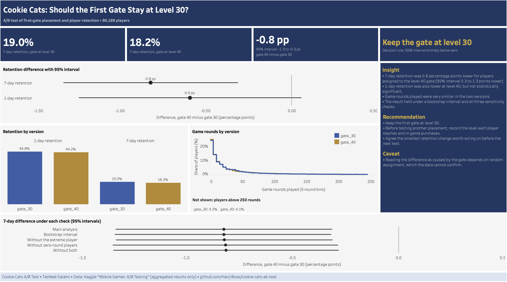

# Cookie Cats A/B Test

Analysis of a mobile game A/B test to decide where the first progression gate should sit. Built with the Data Analysis Playbook v3.1.

> **Status:** Complete. Recommendation: keep the first gate at level 30. 7-day retention was 0.8 percentage points lower for players assigned to the level-40 gate.

---

# Results

**Recommendation: keep the first gate at level 30.** Under the decision rule set before the data was examined, the 95% confidence interval for the 7-day retention difference lies entirely below zero.

| Measure | Gate at level 30 | Gate at level 40 | Difference (level 40 − level 30) |
|---------|------------------|------------------|----------------------------------|
| 7-day retention (primary) | 19.0% | 18.2% | −0.8 pp (95% CI −1.3 to −0.3), p = 0.002 |
| 1-day retention (secondary) | 44.8% | 44.2% | −0.6 pp (95% CI −1.2 to +0.1), not statistically significant |
| Game rounds, median (exploratory) | 17 | 16 | Very similar distributions |

- The 7-day result held under a bootstrap interval and when the player with an extreme number of rounds, the players with no rounds, or both were excluded.
- Reading the difference as caused by the gate depends on random assignment, which the data cannot confirm. The sample ratio test raised no alert (p = 0.009 against an alert level of 0.001).
- The data has no revenue or purchase information, so the commercial value of the difference is not estimated.

**Dashboard:** [Tableau Public](https://public.tableau.com/views/CookieCats-ShouldtheFirstGateStayatLevel30/CookieCatsShouldtheFirstGateStayatLevel30) · **Full summary:** [docs/executive_summary.md](docs/executive_summary.md)



---

# Business Problem

Cookie Cats is a mobile puzzle game. According to the Kaggle dataset description, players meet gates at set levels, where they must wait or make an in-app purchase before continuing. The first gate sits at level 30. A test moved it to level 40 for some players, and the team needs to decide whether to move the gate, keep it at level 30, or keep testing before making a change.

# Business Question

Does moving the first gate from level 30 to level 40 change player retention among players who installed the game during the test?

---

# Approach

- **Primary metric:** 7-day retention. **Secondary:** 1-day retention. **Guardrail (exploratory):** total game rounds
- **Decision rule, set before any data was examined:** two-sided tests at the 5% significance level. With Δ = 7-day retention for gate_40 minus 7-day retention for gate_30: if the 95% confidence interval for Δ is entirely above zero, move the gate to level 40; if it is entirely below zero, keep it at level 30; otherwise, collect more evidence. A statistically clear difference does not by itself show that the difference is large enough to matter commercially, so its size is reported alongside the decision
- **Validity checks:** sample ratio test before reading any effect, plus robustness checks reported alongside the main result
- **Stack:** BigQuery (SQL), Python in Jupyter, Tableau

Full scoping (hypotheses, metric definitions, scope, risks and assumptions): [PROJECT_INFO.md](PROJECT_INFO.md)

This is a portfolio project on public learning data. The stakeholders are modelled on a typical mobile game studio, and the findings are not evidence about any real game.

---

# Dataset

| Item | Details |
|------|---------|
| Source | Kaggle: `yufengsui/mobile-games-ab-testing`, originally from DataCamp project 184 |
| Contents | One row per player: `userid`, `version` (`gate_30` or `gate_40`), `sum_gamerounds`, `retention_1`, `retention_7`. No revenue, level or date columns |
| Licence | Listed as Unknown on Kaggle. The data is not redistributed here; download it from the source. The dashboard publishes aggregated results only |
| Size | 90,189 players, 5 columns. The test period is not recorded in the data |

The data is not stored in this repository. See Reproducibility for how to download it.

---

# Progress

- [x] Phase 0 — Scoping & Project Setup
- [x] Phase 1 — Data Loading, Cleaning & Exploration
- [x] Phase 2 — Business Analysis
- [x] Phase 3 — Analytical Method Selection
- [x] Phase 4 — Advanced Analytics & Modelling
- [x] Phase 5 — Reporting, Communication & Publication

---

# Reproducibility

Requirements: Python 3.13, the Google Cloud CLI, and a Google account.

1. Clone the repository and create the environment:
```bash
   git clone <repository-url>
   cd cookie-cats-ab-test
   python3 -m venv .venv
   source .venv/bin/activate
   pip install -r requirements.txt
```
2. Create a Google Cloud project and use BigQuery in sandbox mode. A billing account is not required for the sandbox, which has its own limits (for example, no DML statements and tables that expire after 60 days). Check in the BigQuery console that the project shows as a sandbox before continuing. Then log in and create the dataset:
```bash
   gcloud config set project YOUR_PROJECT_ID
   gcloud auth application-default login
   gcloud auth application-default set-quota-project YOUR_PROJECT_ID
   bq --location=US mk --dataset YOUR_PROJECT_ID:cookie_cats
```
3. Copy `.env.example` to `.env` and fill in your project ID.
4. Download the dataset from the Kaggle page (`yufengsui/mobile-games-ab-testing`), extract `cookie_cats.csv` into `data/raw/`, and check it is the same file used here:
   ```bash
   shasum -a 256 data/raw/cookie_cats.csv
   ```
   The result should be `9f53027065840672e77303281289988371d4a6b67c7dcd3bd4e6306a2a263dc8`.
5. Run `notebooks/01_data_loading.ipynb`. It loads the CSV into the BigQuery table `cookie_cats.raw_cookie_cats`.
6. In the BigQuery console, with your project selected, run Section 3 of `sql/01_data_preparation.sql` to build `cookie_cats.clean_cookie_cats`, then Section 4 to check it against the raw table. Sections 1 and 2 are the profiling and investigation queries.
7. Run `notebooks/02_cleaning_eda.ipynb` for the exploratory analysis.
8. Run `notebooks/03_business_analysis.ipynb`. It runs the sample ratio test and the descriptive queries from `sql/02_business_analysis.sql` (which can also be run section by section in the BigQuery console) and saves the two Phase 2 charts to `outputs/`.
9. Run `notebooks/04_statistical_testing.ipynb` for the statistical tests, the minimum detectable difference and the robustness and sensitivity checks. Its section 4.7 writes the three summary tables in `tableau/data/` used by the dashboard.
10. Open `tableau/cookie_cats_dashboard.twbx` in Tableau Public (desktop) to view or rebuild the dashboard.

No service account key file is used; authentication relies on your own Google login.

---

# Repository Structure

```text
cookie-cats-ab-test/
├── assets/            # Images used in documentation
├── data/
│   ├── raw/           # Downloaded data (not committed)
│   └── processed/     # Cleaned outputs (not committed)
├── docs/              # Phase documents, registers and notes
├── notebooks/         # Jupyter notebooks, run in numbered order
├── outputs/           # Finished charts (chart_*.png) and result tables
├── reports/           # Written reports
├── sql/               # BigQuery SQL scripts, run in numbered order
├── tableau/           # Dashboard files
├── .env.example       # Template for local configuration
├── PROJECT_INFO.md    # Project charter
├── README.md
└── requirements.txt
```

---

# Documentation

| Document | Purpose |
|----------|---------|
| [PROJECT_INFO.md](PROJECT_INFO.md) | Project charter: question, metrics, decision rules, scope, risks |
| [docs/phase_00_setup.md](docs/phase_00_setup.md) | Phase 0 record: setup, issues and exit checklist |
| [docs/phase_01_data_preparation.md](docs/phase_01_data_preparation.md) | Phase 1 record: data acquisition, profiling, cleaning and exploration |
| [docs/phase_02_business_analysis.md](docs/phase_02_business_analysis.md) | Phase 2 record: sample ratio test and descriptive comparison by version |
| [docs/phase_03_method_selection.md](docs/phase_03_method_selection.md) | Phase 3 record: methods chosen for testing and why |
| [docs/phase_04_advanced_analysis.md](docs/phase_04_advanced_analysis.md) | Phase 4 record: test results, decision and validity notes |
| [docs/executive_summary.md](docs/executive_summary.md) | Recommendation and findings for decision-makers |
| [docs/presentation_notes.md](docs/presentation_notes.md) | Three-minute dashboard walk-through and prepared answers to likely questions |
| [docs/tableau_blueprint.md](docs/tableau_blueprint.md) | Dashboard plan, design system and validation |
| [docs/data_dictionary.md](docs/data_dictionary.md) | Definition of every column |
| [docs/cleaning_log.md](docs/cleaning_log.md) | Every change between the raw and clean tables |
| [docs/project_glossary.md](docs/project_glossary.md) | Terms used in the project |
| [docs/assumption_register.md](docs/assumption_register.md) | Assumptions and their validation status |
| [docs/security_notes.md](docs/security_notes.md) | Security checks and data handling |
| [docs/published_surfaces.md](docs/published_surfaces.md) | Every place the findings appear outside this repository |
| [docs/documentation_index.md](docs/documentation_index.md) | Index of all project documents |

---

# License

The code and documentation in this repository are released under the MIT License. The dataset is not covered by this licence; its terms are set by its Kaggle listing.
